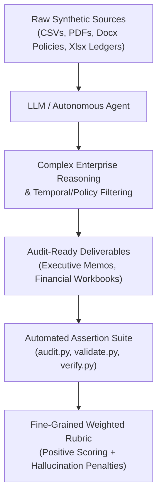
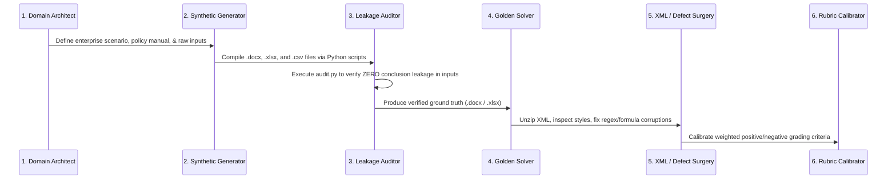

# 🌸 Geranium Benchmark Suite: Enterprise AI Evaluation Architecture

> **A Multi-Modal, High-Complexity Benchmark Engineering Repository for Frontier AI Evaluation**
> 
> *Covering Banking & CECL Reserves, Trade Credit Underwriting, Property & Casualty Forensic Claims, Total Rewards & Compensation Modeling, Private Wealth Planning, M&A Due Diligence, Cyber Liability Underwriting, and Regulatory Examinations.*

---

## 📑 Table of Contents
1. [Executive Summary & The Crux of Geranium](#-executive-summary--the-crux-of-geranium)
2. [Why Geranium Exists: The Benchmark Problem](#-why-geranium-exists-the-benchmark-problem)
3. [Repository Architecture & Directory Map](#-repository-architecture--directory-map)
4. [The 6-Stage Engineering & Calibration Lifecycle](#-the-6-stage-engineering--calibration-lifecycle)
5. [Exhaustive Task-by-Task Analysis](#-exhaustive-task-by-task-analysis)
   * [Task 2: Trade Credit Underwriting (Hartsfield / Crestline)](#1-task-2-trade-credit-underwriting-hartsfield--crestline)
   * [Task 3: ALLL / CECL Reserve Adequacy (Tri-County Community Bank)](#2-task-3-alll--cecl-reserve-adequacy-tri-county-community-bank)
   * [Task 4: P&C Forensic Fire Claim Settlement (Bluegrass Precision Tooling)](#3-task-4-pc-forensic-fire-claim-settlement-bluegrass-precision-tooling)
   * [Task 4 (Millgate): Salary Structure & Total Rewards Modeling](#4-task-4-millgate-salary-structure--total-rewards-modeling)
   * [Task 5: Wealth Management & Retirement Readiness (Daniel & Renee Pruitt)](#5-task-5-wealth-management--retirement-readiness-daniel--renee-pruitt)
   * [Titan: Enterprise M&A Technology Due Diligence](#6-titan-enterprise-ma-technology-due-diligence)
   * [NovaMart: Commercial Cyber Liability Underwriting](#7-novamart-commercial-cyber-liability-underwriting)
   * [Geranium Refinement Suite: Specialized Industry Tasks](#8-geranium-refinement-suite-specialized-industry-tasks)
6. [Technical Innovations & Common Defects Solved](#-technical-innovations--common-defects-solved)
7. [Environment Setup & Automation Scripts](#-environment-setup--automation-scripts)
8. [Git & Repository Structure](#-git--repository-structure)

---

## 🎯 Executive Summary & The Crux of Geranium

The **Geranium Project** is a production-grade benchmark engineering workspace developed to test, validate, and stress-test autonomous AI reasoning agents on real-world, high-stakes corporate knowledge work.

Unlike traditional AI benchmarks (e.g., MMLU, GSM8K, HumanEval) that evaluate single-prompt question-answering or isolated algorithmic code snippets, **Geranium evaluates multi-modal enterprise operations**. Each task in this workspace mirrors the daily workflow of a specialized senior professional (VP of Total Rewards, Senior Credit Analyst, ALLL Committee Chair, Forensic Property Adjuster, M&A Technical Director, or Cyber Underwriter).

### The Four Pillars of the Geranium Crux
1. **Multi-Document Synthesis Across Heterogeneous Formats**: An agent is provided with 5 to 10 unstandardized corporate source files—spanning raw Excel spreadsheets (`.xlsx`), unstructured Word policies and memos (`.docx`), PDF financial filings (`10-K` / `10-Q`), raw transaction CSVs, and email correspondence.
2. **Strict Temporal & Policy Boundary Filtering**: The benchmark contains intentional "traps" where standard arithmetic fails if policy boundaries are overlooked (e.g., filtering invoices outside a 90-day window, distinguishing working days from calendar days, or identifying pre-computed stale ratios).
3. **Audit-Level Quantitative Precision**: Tasks demand multi-step calculations (Altman Z-scores, CECL loan pooling, coinsurance ratios, LTM EBITDA bridges, Monte Carlo decumulation schedules) where intermediate values must precisely match ground-truth formulas.
4. **Document Engineering & XML Repair**: Evaluates the synthesis of fully styled, publication-ready Microsoft Office deliverables (`.docx` and `.xlsx`) with live formulas, proper hierarchy, and professional aesthetics.



---

## 🔬 Why Geranium Exists: The Benchmark Problem

Frontier AI models frequently hallucinate or rely on lazy heuristics when confronted with enterprise tasks:
* **The "Trust the Table" Trap**: Pre-calculated summary tables often contain stale or intentionally corrupted data (e.g., a covenant compliance sheet with incorrect DSCR flags or an account list showing outdated loss ratios). Models tend to trust these numbers blindly rather than recalculating from source financials.
* **The "Ignore Boundaries" Trap**: When asked for a trailing 3-month average, naive models compute an average across all rows in the spreadsheet rather than enforcing calendar cutoff dates.
* **The "Lump and Settle" Trap**: In insurance claims, models often accept public adjusters' lump-sum demands rather than separating base repairs from code-upgrade ordinance requirements or enforcing statutory coinsurance penalties.
* **The "Commercial Bias" Trap**: In underwriting simulations, models frequently yield to broker pressure to close deals rather than strictly enforcing non-waivable risk decline gates (e.g., missing MFA or EDR).

The Geranium project was built to programmatically instantiate, verify, and grade these exact failure modes.

---

## 📂 Repository Architecture & Directory Map

```
geranium-project/
├── Task2/                              # Trade Credit Underwriting (Hartsfield / Crestline)
│   ├── new_files/                      # Rebuilt source files, scripts, and FINAL rubrics
│   ├── prompt_and_rubric_FINAL6.txt    # 29-criterion weighted grading rubric
│   ├── TASK2_TRADE_CREDIT_ANALYSIS.md  # Detailed Task 2 Deep-Dive Spec
│   └── task.toml                       # Sector and difficulty tier metadata
│
├── Task3/                              # ALLL / CECL Reserve Adequacy (Tri-County Bank)
│   ├── build_final8_golden.py          # Ground-truth Word memo generator
│   ├── apply_final8_fixes.py           # Programmatic repair script
│   ├── rubric_FINAL8.md                # 35+ criterion CECL audit rubric
│   ├── prompt_FINAL8.txt               # Authoritative prompt instructions
│   └── TASK3_ALLL_CECL_BANKING.md      # Detailed Task 3 Deep-Dive Spec
│
├── Task4/                              # P&C Forensic Fire Claim (Bluegrass Precision Tooling)
│   ├── build_docx_inputs.py            # Generates policy and claim submission docs
│   ├── build_xlsx_inputs.py            # Generates contractor estimates & financials
│   ├── build_pivot2_golden.py          # Solves coinsurance, ACV/RCV, & business income
│   ├── rubric_PIVOT2.md                # Multi-coverage settlement rubric
│   └── TASK4_BLUEGRASS_FIRE_CLAIM.md   # Detailed Task 4 Deep-Dive Spec
│
├── Task4_millgate/                     # Salary Structure & Total Rewards (Millgate Mutual)
│   ├── work/                           # Calculation engine (build_workbook.py, cost.py)
│   ├── inputs_extract/                 # Market surveys, job points, and state wage floors
│   ├── golden_extract/                 # Verified ground-truth Excel workbook
│   └── TASK4_MILLGATE_COMPENSATION.md  # Detailed Millgate Compensation Spec
│
├── Task5/                              # Wealth Planning & Retirement (Daniel & Renee Pruitt)
│   ├── build_golden_v2.py              # CFP-grade retirement readiness generator
│   ├── fix_task5.py                    # Social Security & inflation calibration script
│   ├── rubric_PIVOT3b_v4.md            # 49-criterion comprehensive rubric
│   └── TASK5_PRUITT_RETIREMENT_PLANNING.md # Detailed Task 5 Wealth Planning Spec
│
├── Titan/                              # M&A Tech Due Diligence (Project Titan Acquisition)
│   ├── audit.py                        # Automated multi-file leakage & grounding auditor
│   ├── validate.py                     # Programmatic assertion engine
│   ├── fix_golden.py                   # Word XML structure repair script
│   ├── RUBRIC_ADDITIONS.md             # Adjudication criteria (SLA §4.5.a / §4.5.b)
│   └── TITAN_MA_DUE_DILIGENCE.md       # Detailed Project Titan Spec
│
├── NovaMart_extracted/                 # Cyber Liability Underwriting (NovaMart Wholesale)
│   ├── build_golden_fixed.py           # Solves base rating, multipliers, & decline gates
│   ├── fix_reviewer_issues.py          # XML repair & formatting pipeline
│   ├── prompt_and_rubric.txt           # Cyber underwriting prompt & 21-point rubric
│   └── NOVAMART_CYBER_UNDERWRITING.md  # Detailed NovaMart Spec
│
├── GERANIUM REFINEMNET/                # Iterative Model Benchmark Lab & Sub-Tasks
│   ├── Task2/                          # Cottonwood Market Conduct Examination (Kansas MC-9)
│   ├── TASK3/                          # Arizona Monsoon Auto Appraisal Quality Review
│   ├── Task4/                          # QSR Trading Comps Model (MCD, YUM, DPZ 10-K/10-Q)
│   ├── Task5/ & task7/                 # Granite Ridge Specialty Renewal Underwriting
│   ├── linn_county_corn_rp...xlsx      # Crop Insurance Actuarial Pricing Indication
│   ├── fix_golden_and_rubric.py        # Granite Ridge multi-tab repair suite
│   ├── apply_live_formulas.py          # Openpyxl dynamic formula injection
│   └── GERANIUM_REFINEMENT_TASKS.md    # Comprehensive Refinement Suite Spec
│
├── work_fix/                           # Surgical docx/xlsx patch workspace (regex repairs)
├── geranium_scratch_fix_allldata.py    # ALLL 8-quarter loss trend & methodology builder
└── README.md                           # Master Architecture & Repository Overview (This File)
```

---

## 🔄 The 6-Stage Engineering & Calibration Lifecycle

Every benchmark task in Geranium follows a rigorous 6-stage engineering pipeline:



1. **Drafting & Policy Specification**: Ground the problem in actual regulatory guidelines (e.g., CECL ASC 326, Kansas Insurance Bulletin MC-9, ISO CP-0010, SEC Form 10-K rules).
2. **Synthetic Data Synthesis**: Develop `build_*.py` and `generate_*.py` scripts to manufacture clean, realistic multi-file data packages.
3. **Automated Leakage Sweeping (`audit.py`)**: Scan all input documents to guarantee that key analytical conclusions (e.g., deal recommendations, memory overages, failure counts) are **not leaked or pre-stated** in input text.
4. **Golden Solution Engineering**: Build the reference output using automated scripts and domain experts, verifying that every single number ties back to source inputs.
5. **XML-Level Document Surgery**: Modern `.docx` and `.xlsx` files are zipped XML trees (`word/document.xml`, `xl/worksheets/sheet1.xml`). Scripts programmatically manipulate table borders, cell shading, font runs, and live dynamic formulas.
6. **Rubric Calibration & Benchmark Scoring**: Draft fine-grained rubrics featuring heavy positive weights for core calculations and strict negative penalties (-2 to -5 points) for hallucinations or policy shortcuts.

---

## 📊 Exhaustive Task-by-Task Analysis

### 1. Task 2: Trade Credit Underwriting (Hartsfield / Crestline)
* 📖 **Detailed Document**: [TASK2_TRADE_CREDIT_ANALYSIS.md](file:///c:/Users/user/OneDrive/Desktop/geranium%20project/Task2/TASK2_TRADE_CREDIT_ANALYSIS.md)
* **What Was Done**: Built an unsecured credit decision memo for Hartsfield Polymer Technologies ($1.5M credit limit request) under Crestline Credit Policy. Evaluated liquidity, leverage, H1 2026 margin compression, Altman Z-score, AR ledger payment turnaround times, and D&B public records.
* **Why It Was Done**: Tests multi-file temporal filtering and deterministic policy enforcement. The prompt requires evaluating the AR ledger over a strict 3-month window (May 20 to August 20, 2026). Invoices outside this window (`INV-10611` on May 15) must be excluded.
* **What Was Solved**:
  * Corrected invoice window boundary interpretation: When `INV-10611` is properly excluded, the average Days to Pay is **45.25 days** (violating the 45.0-day policy ceiling). Naive models average all paid invoices (~39.5 days) and pass the credit.
  * Solved Altman Z-score calculation divergence: Calibrated private manufacturing formula weights ($Z = 1.77$, failing the 1.80 threshold).
  * Enforced Section 4(b) mandatory **DECLINE** due to an active $45,000 State Tax Lien.

---

### 2. Task 3: ALLL / CECL Reserve Adequacy (Tri-County Community Bank)
* 📖 **Detailed Document**: [TASK3_ALLL_CECL_BANKING.md](file:///c:/Users/user/OneDrive/Desktop/geranium%20project/Task3/TASK3_ALLL_CECL_BANKING.md)
* **What Was Done**: Executed a comprehensive Q4 2025 ALLL Reserve Adequacy Assessment for Tri-County Community Bank across seven workbooks, testing whether the booked reserve ($812,000) falls within the Board's +/- 10% tolerance band.
* **Why It Was Done**: Tests an agent's skepticism and audit capability. The provided `Covenant_Compliance_Workbook` contains pre-calculated compliance flags, but policy mandates independent recalculation of DSCR, LTV, and Current Ratio from raw balance sheets.
* **What Was Solved**:
  * Resolved entity naming discrepancies across workbooks using `rename_borrowers.py`.
  * Generated 8 quarters of historical loss trends and Model Risk Committee methodology notes in `geranium_scratch_fix_allldata.py`.
  * Carved out the impaired credit (Summit Ridge Properties, Rating 6, $1.17M balance) from pooled treatment, calculating its specific reserve via the Collateral Dependent Method with a 10% liquidation haircut.
  * Calibrated rubrics up to `rubric_FINAL8.md` (35+ criteria).

---

### 3. Task 4: P&C Forensic Fire Claim Settlement (Bluegrass Precision Tooling)
* 📖 **Detailed Document**: [TASK4_BLUEGRASS_FIRE_CLAIM.md](file:///c:/Users/user/OneDrive/Desktop/geranium%20project/Task4/TASK4_BLUEGRASS_FIRE_CLAIM.md)
* **What Was Done**: Conducted a forensic claim settlement recommendation for structural fire claim `CLM-2025-08841` under a commercial property policy. Reconciled building damage, personal property, ordinance or law upgrades, and business interruption losses.
* **Why It Was Done**: Tests legal contract interpretation, ensuing loss doctrines, and mathematical coinsurance penalties.
* **What Was Solved**:
  * Correctly applied the Ensuing Loss Clause: The fire originated from unpermitted 2023 electrical work. While repairing the electrical panel itself is excluded as faulty workmanship, the resulting fire destruction is covered.
  * Unbundled contractor estimates: Extracted $185,000 of mandatory 2024 code upgrades from base building repairs, routing them into the Ordinance or Law sub-limit.
  * Disallowed public adjuster's request to waive coinsurance, computing independent penalties on Building and Business Personal Property based on the Statement of Values appraisal.
  * Enforced Actual Cash Value (ACV) depreciation holdbacks on machinery until replacement occurs.

---

### 4. Task 4 (Millgate): Salary Structure & Total Rewards Modeling
* 📖 **Detailed Document**: [TASK4_MILLGATE_COMPENSATION.md](file:///c:/Users/user/OneDrive/Desktop/geranium%20project/Task4_millgate/TASK4_MILLGATE_COMPENSATION.md)
* **What Was Done**: Designed the 2027 base salary structure and implementation costing model for Millgate Mutual, producing a 4-tab live specification spreadsheet.
* **Why It Was Done**: Evaluates deterministic, multi-phase algorithmic computation across 10 distinct steps without human oversight.
* **What Was Solved**:
  * Engineered band geometry: 50-point bins, benchmark eligibility filtering ($\le 24$ months, $\ge 5$ incumbents), market aging (3.2%/yr pro-rata by whole month), survey blending (Cranmere 60% / Delaney 40%), and linear interpolation across empty grades.
  * Implemented Step Band Repair: Corrected midpoint steps outside the 8%–14% corridor by shifting upper grade midpoints inward to the nearest permitted hundred.
  * Built Zone Structure & Continuity Floors: Integrated geographic factors (0.92, 1.00, 1.12) with state wage floors.
  * Automated incumbent costing over active roster employees as of Feb 1, 2027, applying the budget phase-in rule when total cost breached the $355,000 board cap.

---

### 5. Task 5: Wealth Management & Retirement Readiness (Daniel & Renee Pruitt)
* 📖 **Detailed Document**: [TASK5_PRUITT_RETIREMENT_PLANNING.md](file:///c:/Users/user/OneDrive/Desktop/geranium%20project/Task5/TASK5_PRUITT_RETIREMENT_PLANNING.md)
* **What Was Done**: Developed a comprehensive Retirement Readiness Assessment (`.docx`) for Daniel (60) and Renee (60) Pruitt, evaluating their goal to retire at age 62.
* **Why It Was Done**: Tests multi-year cash flow projections, tax-efficient withdrawal sequencing, and fiduciary judgment.
* **What Was Solved**:
  * Proved that claiming Social Security at 62 produces a **$529,795 capital deficit**, failing the firm's 4% sustainability screen.
  * Modeled delay scenarios to Age 65 and Full Retirement Age (FRA) 67 with bridge drawdown and ongoing 6% compounding, proving that delaying claiming restores plan solvency.
  * Solved the healthcare bridge trap: Handled the $21,600/year cost for bridge years 62–64 without erroneously compounding inflation twice.
  * Optimized withdrawal order: Taxable brokerage $\rightarrow$ Tax-deferred 401(k)/403(b) $\rightarrow$ Roth IRA preserved last, executing rebalancing inside pre-tax accounts to protect the $65,000 taxable capital gain.
  * Calibrated rubric to `rubric_PIVOT3b_v4.md` with 7 strict negative hallucination penalties.

---

### 6. Titan: Enterprise M&A Technology Due Diligence
* 📖 **Detailed Document**: [TITAN_MA_DUE_DILIGENCE.md](file:///c:/Users/user/OneDrive/Desktop/geranium%20project/Titan/TITAN_MA_DUE_DILIGENCE.md)
* **What Was Done**: Conducted technical due diligence on the acquisition of Project Titan, synthesizing cloud stress tests, GDPR checklists, migration pilots, vulnerability scans, and C-suite sign-offs into an executive report.
* **Why It Was Done**: Tests high-stakes enterprise governance and multi-stream defect reconciliation.
* **What Was Solved**:
  * Built an automated leakage auditor (`audit.py`) ensuring deal conclusions (e.g., 112% memory burst, 16/23 failed pilots, "Conditional Go") were never pre-stated in input files.
  * Identified STRESS-001 P99 SLA failure invoking Policy §4.5.b, which permits a **Conditional Go** solely upon locating VP Engineering Raj Malhotra's written risk acceptance in the tracker.
  * Reconciled conflicting CVSS vulnerability ratings under Section 3.1 effective severity weighting.
  * Programmatically repaired docx table styling (`fix_golden.py`) and validated assertions via `validate.py`.

---

### 7. NovaMart: Commercial Cyber Liability Underwriting
* 📖 **Detailed Document**: [NOVAMART_CYBER_UNDERWRITING.md](file:///c:/Users/user/OneDrive/Desktop/geranium%20project/NovaMart_extracted/NOVAMART_CYBER_UNDERWRITING.md)
* **What Was Done**: Evaluated NovaMart Inc.'s $15M Cyber Liability insurance application, calculating base premium ($25,120), loss run surcharges (1.20x), security multipliers (1.25x), and final premium ($37,680).
* **Why It Was Done**: Tests underwriting discipline when aggressive brokers pressure underwriters to meet competitive quotes ($45,000) despite fatal risk controls.
* **What Was Solved**:
  * **The Regex Dollar-Stripping Bug**: Discovered and resolved a systemic regex bug that stripped `$` and numeric tokens (e.g., converting `$15,000,000` to ` limit`). Restored document XML runs in `work_fix/apply_fixes.py`.
  * Enforced mandatory **DECLINE** under Section 6: NovaMart deployed EDR on 98% of endpoints, but policy mandates 100% coverage (a 2% gap is an automatic, non-waivable decline).
  * Flagged CVE-2023-4528 Critical vulnerability on the perimeter VPN appliance and enforced Section 8 immediate file closure protocol.

---

### 8. Geranium Refinement Suite: Specialized Industry Tasks
* 📖 **Detailed Document**: [GERANIUM_REFINEMENT_TASKS.md](file:///c:/Users/user/OneDrive/Desktop/geranium%20project/GERANIUM%20REFINEMNET/GERANIUM_REFINEMENT_TASKS.md)
* **Sub-Tasks Included**:
  1. **Granite Ridge Specialty Renewal Underwriting (Task 5 & 7)**: 36 habitational accounts, 75 locations. Recomputed 36-month loss ratios, excluded catastrophe claim `CAT-2408`, identified unit/TIV schedule variances on `GR-2113`, declined `GR-2195` (292.3% loss ratio), and injected dynamic Excel formulas via `apply_live_formulas.py`.
  2. **QSR Comps Valuation Model (Task 4)**: Built an investment banking trading comps workbook for McDonald's, Yum!, and Domino's from SEC 10-K/10-Q filings, normalizing EBITDA, extracting cash-flow D&A, and tax-effecting Domino's one-time items.
  3. **Cottonwood Market Conduct Examination (Task 2)**: Tested claims handling against Kansas Insurance Department Bulletin MC-9, enforcing working day vs calendar day filtering, statutory total loss fees ($42.50 + 7.5% sales tax), and zero-tolerance standards.
  4. **Arizona Monsoon Appraisal Quality Review (TASK 3)**: Audited 32 closed collision files, isolating 98.1% ($4,414.75) of leakage exposure to a single body shop (F-211).
  5. **Linn County Corn Revenue Protection Pricing Indication**: Actuarial USDA RMA crop revenue protection pricing model using CME options volatility and county historical yields.

---

## 🛠️ Technical Innovations & Common Defects Solved

| Defect / Challenge | Root Cause | Engineering Solution Implemented |
| :--- | :--- | :--- |
| **Regex Token Stripping** | Regex patterns removing `$` and leading numbers | Created run-level docx XML replacement scripts (`work_fix/apply_fixes.py`) to safely restore exact currency strings. |
| **Input Data Leakage** | Summary tables inadvertently containing answers | Built `audit.py` to regex-sweep all 7 input files for banned tokens and pre-computed percentages before finalizing bundles. |
| **Static vs Live Formulas** | Excel goldens containing hardcoded values | Deployed `apply_live_formulas.py` and `openpyxl` to inject dynamic Excel formulas linking cells to source tabs. |
| **Entity Inconsistencies** | Typos across synthetic workbooks | Developed automated harmonization scripts (`rename_borrowers.py`) ensuring 100% entity matching across documents. |
| **Word Table XML Corruption** | Corrupted cell borders and widths in docx | Unzipped docx archives into `word/document.xml`, applied XML cleaning, and re-zipped via automated pipelines. |
| **Rubric Ambiguity** | Lenient rubrics rewarding lucky guesses | Upgraded rubrics to include intermediate arithmetic steps, strict tolerances, and negative penalty criteria (-3 to -5). |

---

## 💻 Environment Setup & Automation Scripts

### Prerequisites
* Python 3.10+
* Git 2.30+
* Microsoft Office (or LibreOffice) for previewing DOCX/XLSX deliverables

### Python Dependencies
Install required packages via pip:
```bash
pip install openpyxl python-docx pandas numpy
```

### Key Execution Scripts
* **Audit Inputs for Leakage (Titan)**:
  ```bash
  python Titan/audit.py
  ```
* **Verify ALLL Banking Calculations (Task 3)**:
  ```bash
  python Task3/final_verify_task3.py
  ```
* **Inject Live Formulas in Granite Ridge (Refinement)**:
  ```bash
  python "GERANIUM REFINEMNET/Task5/apply_live_formulas.py"
  ```
* **Rebuild Trade Credit Decision Memo (Task 2)**:
  ```bash
  python Task2/new_files/generate_docs.py
  ```
* **Run NovaMart Verification (Cyber Underwriting)**:
  ```bash
  python NovaMart_extracted/final_verify.py
  ```

---

## 📦 Git & Repository Structure

To push this entire project into a unified Git repository:
1. Initialize Git in the root workspace:
   ```bash
   git init
   ```
2. Configure `.gitignore` to omit unnecessary local editor caches while retaining all datasets, scripts, models, and documentation.
3. Stage and commit all files:
   ```bash
   git add .
   git commit -m "Initial commit: Complete Geranium Benchmark Suite with comprehensive task specs"
   ```
4. Link to your remote GitHub / GitLab repository:
   ```bash
   git remote add origin <YOUR_REMOTE_REPO_URL>
   git branch -M main
   git push -u origin main
   ```

---

*Authored & Engineered for the Geranium Benchmark Evaluation Project.*
