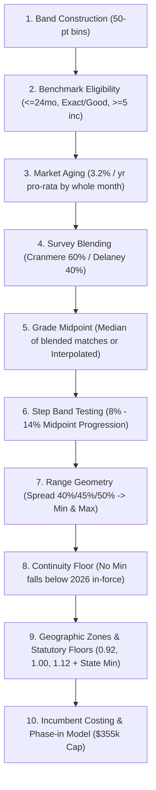

# Task 4 (Millgate): Salary Structure Specification & Total Rewards Costing

## 📌 Executive Summary & Task Overview
* **Domain**: Human Resources / Compensation Architecture / Total Rewards Actuarial Modeling
* **Target Role**: Lead Compensation Analyst
* **Organization**: Millgate Mutual
* **Project**: 2027 Base Salary Structure Specification & Implementation Costing
* **Key Stakeholders**: Dov Ferreira (VP Total Rewards), Pilar (HRIS Data Load Lead), Board of Directors
* **Effective Date**: January 1, 2027 (Pay adjustments effective February 1, 2027)
* **Approved Board Budget**: $355,000 cash implementation cap
* **Core Deliverable**: `Millgate_2027_Salary_Structure_Specification.xlsx`

---

## 🎯 Purpose & Why This Task Was Designed
This task assesses an AI agent's capability to execute deterministic, algorithmic compensation architecture across multiple mathematical steps, boundary checks, and payroll costing calculations without skipping rules or taking rounding shortcuts.

### Source Files & Raw Inputs
1. `design_standard_dump.txt`: The definitive Millgate Mutual Salary Structure Design Standard (revised Sept 2026), governing band geometry, benchmark aging, step repair, range spread, zone factors, and statutory floors.
2. `budget_memo_dump.txt`: Implementation Budget and Phase-in memo from VP Total Rewards detailing roster eligibility, the $355k board cap, and the two-phase payout formula.
3. `Job_Evaluation_Point_Schedule.csv`: Complete list of jobs with standardized Hay-style evaluation point totals.
4. `market_survey_match_detail.csv`: Salary survey benchmark data from Cranmere and Delaney surveys.
5. `State_Wage_Floor_Schedule_2027.csv`: 2027 statutory minimum wage rates (hourly for non-exempt) and exempt salary thresholds across all operating states.
6. `Incumbent_Roster.csv`: Employee roster with current base salaries, job titles, department, location/state, and employment status dates.

---

## 📐 Deterministic 10-Step Algorithmic Process

### Detailed Rules
1. **Band Construction**: Lowest point score on schedule rounded down to nearest 10 points gives the floor of Grade 1. Bands are 50 points wide. The ladder continues until the highest score is enveloped.
2. **Benchmark Eligibility**: Match must be $\le 24$ months old relative to Jan 1, 2027; scope match recorded as "Exact" or "Good"; sample size $\ge 5$ incumbents.
3. **Market Aging**: Aged to Jan 1, 2027 at **3.2% per year pro-rata by whole month** based on each survey source's effective date.
4. **Weighted Blend**: Cranmere = 60%, Delaney = 40%. If only one source is eligible, that source carries 100%.
5. **Midpoint & Interpolation**: Grade midpoint is the median of eligible benchmark jobs in the band (rounded to nearest $100). Grades with zero benchmarks are linearly interpolated between the nearest benchmarked grades.
6. **Step Band Progression**: Step from one midpoint to the next must be between **8.0% and 14.0%**. Pairs are evaluated ascending. If outside the band, the upper grade midpoint moves inward to the nearest permitted boundary.
7. **Range Geometry**:
   * Grades 1–3: **40% spread**
   * Grades 4–7: **45% spread**
   * Grades 8+: **50% spread**
   * $\text{Grade Minimum} = \text{Midpoint} / (1 + 0.5 \times \text{Spread})$
   * $\text{Grade Maximum} = \text{Minimum} \times (1 + \text{Spread})$
8. **Continuity Floor**: No grade minimum may be lower than the prior 2026 structure in force.
9. **Geographic Zones & Statutory Floors**:
   * **Zone 1 (0.92)**: OH, IN, MO
   * **Zone 2 (1.00)**: CO, IL, MN
   * **Zone 3 (1.12)**: CA, WA, NY
   * Grades with band ceiling $< 420$ points are tested against the annualized hourly state minimum wage ($2080 \text{ hours} \times \text{State Minimum}$). Grades $\ge 420$ points are tested against state exempt salary thresholds. The highest statutory floor in the zone sets the floor, rounded up to next $100.
10. **Incumbent Costing & Budget Phase-In**:
   * Evaluated over active incumbents on **February 1, 2027**. Colleagues on approved leave are costed; colleagues departing prior to Feb 1 are excluded.
   * Salaries above zone maximum are held flat (green-circled; no pay cuts).
   * Total cash movement is compared to the **$355,000 budget cap**.
   * If total cost exceeds $355,000, **Phase-in Rule** is triggered: on Feb 1, 2027, pay the greater of 50% of the shortfall to zone minimum and the amount needed to reach the statutory floor. The remaining balance is paid on Feb 1, 2028.

---

## 🛠️ Scripts & Build Automation
* `build_workbook.py`: Complete Python script using `openpyxl` that builds the four-tab production workbook (`Structure_Overview`, `Grade_Band_Detail`, `Zone_Structures`, `Costing_and_Phase_In`).
* `build5.py`: Mathematical simulation script validating midpoint step repairs and linear interpolation across empty grades.
* `cost.py`: Employee roster costing engine that evaluates employee salaries, flags green/red circles, and computes Phase 1 and Phase 2 payroll expenditure.
* `grades.json` & `costing.json`: Intermediate caching JSON objects tracking each step of grade progression and payroll cost impacts.
