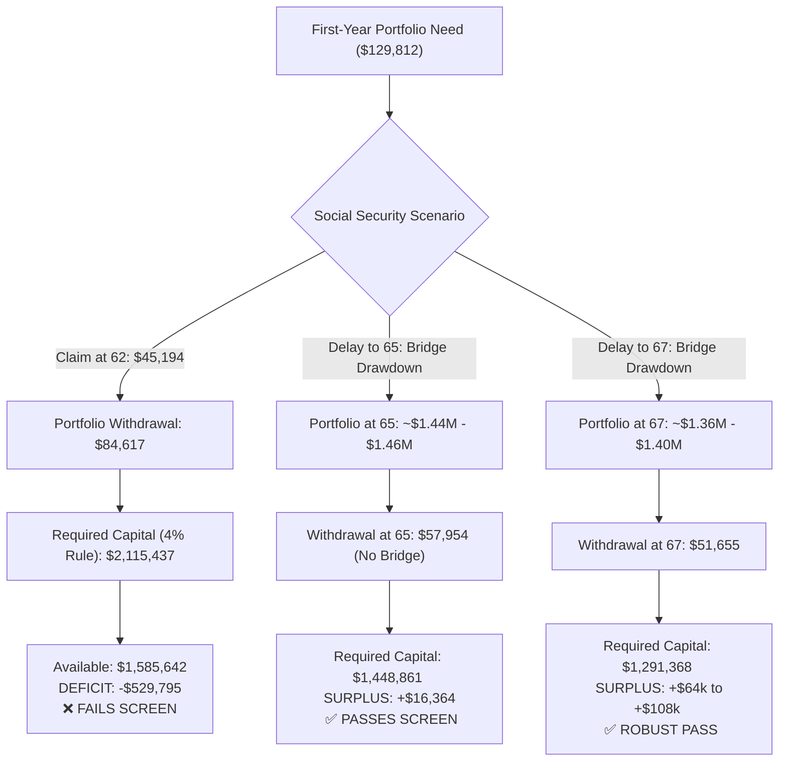

# Task 5: Comprehensive Retirement Readiness & Advisory Assessment (Daniel & Renee Pruitt)

## 📌 Executive Summary & Task Overview
* **Domain**: Wealth Management / Certified Financial Planning (CFP) / Private Banking
* **Target Role**: Senior Wealth Advisor
* **Clients**: Daniel Pruitt (age 60, targeting retirement at 62) & Renee Pruitt (age 60)
* **Planning Horizon**: 2-year pre-retirement window; retirement phase ages 62–92
* **Core Deliverable**: `Pruitt_Retirement_Readiness_Assessment.docx`
* **Core Question**: Can Daniel and Renee afford to both retire at age 62 while maintaining their lifestyle?
* **Final Verdict**: **NO, if Social Security is claimed at 62** (fails the firm's 4% sustainability screen with a ~$530k deficit). **YES, if retirement occurs with Social Security delayed to Age 65 or FRA 67**.

---

## 🎯 Purpose & Why This Task Was Designed
This task evaluates an AI agent's proficiency in multi-year actuarial decumulation modeling, tax-efficient portfolio withdrawal sequencing, Social Security claiming optimization, and fiduciary advisory communication across five client documents:
1. `Account_Statements_Summary.xlsx`
2. `Household_Budget_and_Planning_Assumptions.xlsx`
3. `Social_Security_Benefit_Estimates.docx`
4. `Client_Intake_and_Goals_Summary.docx`
5. `Insurance_and_Estate_Summary.docx`

---

## 📊 Client Financial Profile & Balance Sheet

| Account | Owner | Balance | Asset Allocation | Unrealized Gain |
| :--- | :--- | :--- | :--- | :--- |
| **Traditional 401(k)** | Daniel | $680,000 | 70% Equities / 25% Fixed Income / 5% Cash | Pre-tax |
| **Traditional 403(b)** | Renee | $310,000 | 65% Equities / 30% Fixed Income / 5% Cash | Pre-tax |
| **Joint Taxable Brokerage** | Joint WROS | $215,000 | 75% Equities / 20% Fixed Income / 5% Cash | **$65,000 Capital Gain** |
| **Roth IRA** | Renee | $95,000 | 80% Equities / 15% Fixed Income / 5% Cash | Tax-free |
| **Joint High-Yield Savings** | Joint | $45,000 | 0% Equities / 0% Fixed Income / 100% Cash | Cash Equivalent |
| **Total Investable Assets** | **Household** | **$1,345,000** | **68.1% Equity / 24.8% FI / 7.0% Cash** | - |

---

## 🧮 Quantitative Analysis & Core Planning Engines

### 1. Portfolio Accumulation to Retirement (Age 62)
* Current Balance: $1,345,000 compounded at 6% annual growth over 2 years = **$1,511,242**.
* Scheduled Pre-Retirement Contributions: $74,400 across the two years.
* Projected Portfolio at Age 62: **$1,585,642** (uncredited) or **$1,589,959** (growth-credited).

### 2. Retirement Income Needs Analysis & The Healthcare Bridge
* Current Budget: $9,200/mo ($110,400/yr) $\rightarrow$ Retirement Budget: **$8,500/mo ($102,000/yr)**.
* Base Budget Inflated (3% over 2 years): **$108,212** for Year 1.
* **Healthcare Bridge Trap**: Both spouses retire at 62 and lose employer coverage before Medicare begins at 65. The plan requires **$21,600/year** for 3 years (ages 62, 63, 64). *The workbook explicitly instructs that this $21,600 is already stated in planning dollars and must NOT be inflated a second time.*
* Total First-Year Funding Need: $\$108,212 + \$21,600 = \mathbf{\$129,812}$.

### 3. Social Security Claiming Scenarios

| Claiming Age | Combined Today's Dollars | Combined Nominal Dollars at Claiming | Reduction from FRA 67 |
| :--- | :--- | :--- | :--- |
| **Age 62** | $42,600 / yr ($2,400 + $1,150/mo) | **$45,194 / yr** (inflated 2 yrs @ 3%) | ~30% permanent reduction |
| **Age 65** | $52,008 / yr ($2,947 + $1,387/mo) | **$60,292 / yr** (inflated 5 yrs @ 3%) | **13.3% reduction** (superseded drafts had 9%) |
| **FRA 67** | $60,000 / yr ($3,400 + $1,600/mo) | **$73,792 / yr** (inflated 7 yrs @ 3%) | 0% reduction (Full Benefit) |

### 4. Sustainability Screen (The 4% Initial Withdrawal Rule)

### 5. Fiduciary Tax & Estate Recommendations
1. **Asset Allocation Rebalancing**: Current equity is 68.1% vs the firm's 55% near-retirement target (13% overweight). Rebalancing must be executed inside the **401(k) and 403(b)** to avoid triggering capital gains tax on the $65,000 unrealized gain in the taxable brokerage.
2. **Tax-Efficient Withdrawal Order**:
   * Step 1: Joint Taxable Brokerage (draw cost basis first; realize gains in lower-income bridge years).
   * Step 2: Traditional 401(k) / 403(b) (fill lower tax brackets before RMDs start at age 75).
   * Step 3: Renee's Roth IRA (preserve tax-free compounding for late-in-life longevity and estate legacy).
   * Cash Reserve: Maintain $45,000 joint savings as an emergency liquidity buffer.
3. **Estate & Risk Management Red Flags**:
   * **Long-Term Care (LTC)**: Zero coverage. A cognitive or chronic care event would rapidly deplete the portfolio.
   * **Life Insurance Expirations**: Daniel's term policy expires at age 68; Renee's group policy terminates upon leaving work.
   * **Outdated Estate Plan**: Wills executed in 2011 (15 years old), beneficiaries checked in 2019, and no durable powers of attorney or healthcare directives exist.

---

## 🛠️ Evolution & Rubric Refinement
* `build_golden_v2.py` & `fix_task5.py`: Programmatically generated the golden Word report, embedding precise mathematical tables and narrative justifications.
* `rubric_PIVOT3b_v4.md`: Expanded to a 49-criterion rigorous grading standard. Includes 7 distinct negative-weight penalties (Criteria 43–49) specifically targeting AI hallucinations, incorrect inflation of health bridges, outdated Social Security reduction percentages, or fabrication of client financial facts.
