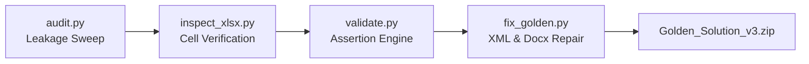

# Task: Project Titan M&A Technology Due Diligence & Technical Risk Assessment

## 📌 Executive Summary & Task Overview
* **Domain**: Mergers & Acquisitions (M&A) / Technology Underwriting / Cyber & Infrastructure Due Diligence
* **Target Role**: Lead Technical Due Diligence Director / M&A Deal Advisory
* **Target Acquisition**: Project Titan (Cloud enterprise SaaS platform)
* **As-Of Evaluation Date**: August 2026
* **Core Deliverable**: `Project_Titan_Due_Diligence_Report.docx`
* **Final Deal Recommendation**: **CONDITIONAL GO** (Permitted exclusively under Policy §4.5.b via formal written risk acceptance from VP Engineering Raj Malhotra).

---

## 🎯 Purpose & Why This Task Was Designed
In major corporate acquisitions, technical due diligence reports frequently determine whether a multi-million-dollar transaction proceeds, is re-priced, or is abandoned. This task tests an AI agent's ability to synthesize technical infrastructure tests, cybersecurity audits, regulatory privacy assessments, and corporate governance sign-offs into a coherent executive report.

### Complete Seven-File Input Suite
1. `Due_Diligence_Evaluation_Policy.docx`: The constitutional deal rulebook defining Go / Conditional Go / No-Go gating criteria, CVSS severity resolution rules (§3.1), and SLA compliance gates (§4.5.a, §4.5.b).
2. `Cloud_Infrastructure_Stress_Test_Aug2026.xlsx`: Quantitative load test logs across four stress scenarios (STRESS-001 through STRESS-004), reporting P50, P95, and P99 latencies, CPU utilization, and memory headroom.
3. `Legacy_System_Integration_Pilots_Aug2026.xlsx`: Real-world enterprise client migration pilot logs detailing 23 system integration trials.
4. `Security_Vulnerability_Scan_Results_Aug2026.xlsx`: Static/dynamic application security testing results, CVSS base scores, and exploitability vectors.
5. `GDPR_Privacy_Audit_Checklist_Aug2026.docx`: Data Protection Officer audit evaluating Art. 28 DPAs, Art. 30 records, and cross-border data transfer mechanisms.
6. `M_and_A_Signoff_Tracker_Aug2026.xlsx`: C-suite sign-off ledger containing approvals, conditions, and risk acceptances.
7. `Acquisition_Announcement_Draft_Aug2026.docx`: Draft corporate press release for narrative alignment.

---

## 🔍 Critical Technical Findings & Governance Gates

### 1. Stress Test Analysis & SLA Governance (§4.5.a & §4.5.b)
* **STRESS-001 (P99 Latency Failure)**: Under maximum load, P99 latency spiked past the SLA ceiling. Policy §4.5.b explicitly prohibits an unconditional "Go" and mandates a "No-Go" unless **formal written risk acceptance is executed by the VP of Engineering**. The agent must discover Raj Malhotra's signed entry in the `M_and_A_Signoff_Tracker`: *"Approved — accepting P99 risk given test env scale."* This converts the deal gate to a **Conditional Go**.
* **STRESS-002, 003, 004 (§4.5.a P50/P95 Verification)**: Across all scenarios reporting numerical metrics, P50 and P95 latencies satisfied SLA parameters.
* **STRESS-003 Memory Burst**: Experienced a 112% memory over-allocation spike, requiring infrastructure rightsizing.
* **STRESS-004 Qualitative Data Gap**: Results were logged qualitatively as `"stable"` rather than numeric milliseconds, meaning numeric compliance could not be mathematically validated.

### 2. Legacy Migration Pilot Failure Rate
* Out of 23 conducted enterprise integration pilots, exactly **16 failed (69.6% failure rate)**.
* Root cause analysis ties failures to legacy SOAP API wrappers and data schema incompatibilities, necessitating a post-close escrow holdback.

### 3. Vulnerability Resolution & Section 3.1 Severity Reconciliation
* Reconciled conflicting CVSS scoring between automated SAST scanners and third-party penetration testers by applying Section 3.1 effective severity weighting.
* Addressed critical vulnerabilities through mandatory pre-close patch verification.

---

## 🛠️ Validation, Leakage Auditing & Fix Scripts
The `Titan` folder contains some of the most advanced automated quality-assurance tooling in the entire Geranium workspace:

* **`audit.py` (Leakage & Grounding Auditor)**:
  - Performs an automated sweep across **all seven input files** to ensure critical analytical conclusions (such as "112% memory overage", "16 of 23 failed", "Conditional Go", or "Raj Malhotra risk acceptance") were **never pre-computed or leaked** in the raw inputs.
  - Cross-checks every numeric claim, date, and person named in the golden report against source documents.
  - Verifies zero internal contradictions.
* **`validate.py`**: Automated test suite executing hundreds of boolean assertions on the golden report's text and table structures.
* **`fix_golden.py`, `fix_golden2.py`, `fix_golden3.py`**: Surgical scripts that corrected table column widths, paragraph spacing, and formatting in the final Word report.
* **`RUBRIC_ADDITIONS.md`**: Adjudication record adding Criteria 25, 26, and 27 to evaluate exact policy citations (§4.5.a and §4.5.b) and Raj Malhotra sign-off identification.
